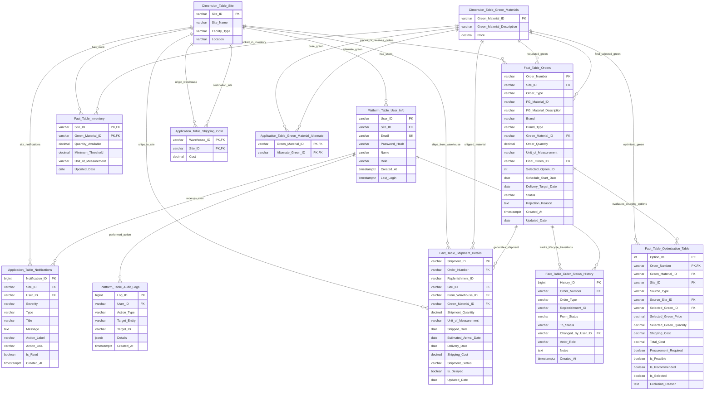

# KDP GreenSource Enterprise — Updated ER Diagram & Schema Guide

## 1. Updated Mermaid Entity-Relationship (ER) Diagram

---

## 2. Summary of Applied Design Decisions

| # | Requested Change | Implementation Details |
|---|---|---|
| **1** | **Update `Fact_Table_Orders`** | Added `Order_Type` (`'PRODUCTION'` vs `'REPLENISHMENT'`). Made finished good columns (`FG_Material_ID`, `FG_Material_Description`, `Brand`, `Brand_Type`) **NULLABLE** so raw bean threshold replenishment orders can be registered seamlessly. |
| **2** | **Add `Fact_Table_Order_Status_History`** | Tracks the 9-stage lifecycle (`new` $\rightarrow$ `approved` $\rightarrow$ `requested` $\rightarrow$ `accepted` $\rightarrow$ `dispatched` $\rightarrow$ `in transit` $\rightarrow$ `delivered` $\rightarrow$ `received` $\rightarrow$ `closed`), supporting both production fulfillment orders (`Order_Number`) and replenishment orders (`Replenishment_ID`). |
| **3** | **Add `Application_Table_Notifications`** | Powers the topbar bell icon and alerts drawer with severity levels (`critical`, `warning`, `info`), deep-link action buttons (`/inventory?tab=stock`, `/orders`), and read state tracking. |
| **4** | **Add `Platform_Table_Audit_Logs`** | System compliance log recording user sign-offs, automated sourcing cascade evaluations, threshold overrides, and warehouse dock scans. |
| **5** | **Merge `Site` and `Warehouse` Tables** | Merged into `Dimension_Table_Site` with `Facility_Type` (`'Local Roasting Plant'` vs `'Central Warehouse'`) and `Location`. Warehouse inventory is excluded as out-of-scope. |
| **6** | **Update `Platform_Table_User_Info`** | Added `Name`, `Role` (`'Local Buyer'` vs `'Warehouse Manager'`), `Created_At`, and `Last_Login`. |
| **7** | **Catalog Simplification** | `Dimension_Table_Green_Materials` retains clean catalog attributes (`Green_Material_ID`, `Green_Material_Description`, `Price`). Minimum thresholds remain in `Fact_Table_Inventory` per site. |
| **8** | **Dynamic Computation in Inventory** | `Quantity_Reserved`, `Quantity_Incoming`, and `Safety_Status` are **NOT** stored as static columns in `Fact_Table_Inventory` — they are dynamically computed on render: `Projected = Available + Incoming - Open Demand`. |
| **9** | **Refine `Fact_Table_Orders`** | Removed static `Assigned_Warehouse_ID` (system calculates the lowest-cost warehouse recommendation dynamically). Added `Selected_Option_ID`, `Rejection_Reason`, and `Delivery_Target_Date`. |
| **10** | **Refine `Fact_Table_Shipment_Details`** | Added `Order_Number` (nullable for production orders) and `Replenishment_ID` (for threshold restocks). Removed `Carrier_Name` and `Tracking_Number`. Added `Shipped_Date`, `Estimated_Arrival_Date`, `Shipping_Cost`, and `Is_Delayed`. |
| **11** | **Enrich `Fact_Table_Optimization_Table`** | Added `Source_Type` (*'Local Inventory'*, *'Local Alternate'*, *'Warehouse Fulfillment'*), `Is_Feasible`, `Is_Recommended`, `Is_Selected`, and `Exclusion_Reason`. |

---

## 3. Codebase and Website Integration Status

- **PostgreSQL DDL**: [db/schema.sql](file:///e:/Akshat/My%20Projects/kdp%20capstone/db/schema.sql) has been updated with the merged site table, dual order types, history, notifications, and logs.
- **Seed Data**: [db/seed.sql](file:///e:/Akshat/My%20Projects/kdp%20capstone/db/seed.sql) has been loaded with sample production demand and threshold replenishment data.
- **Website Mock Data**: [src/data/mockData.js](file:///e:/Akshat/My%20Projects/kdp%20capstone/src/data/mockData.js) provides the merged `SITES`, user profiles, orders with `orderType`, shipments with `estimatedArrivalDate` and `shippingCost`, notifications, and audit logs.
- **Context & Pages**: [OrdersContext.jsx](file:///e:/Akshat/My%20Projects/kdp%20capstone/src/context/OrdersContext.jsx), [Inventory.jsx](file:///e:/Akshat/My%20Projects/kdp%20capstone/src/pages/LocalBuyer/Inventory.jsx), and [Orders.jsx](file:///e:/Akshat/My%20Projects/kdp%20capstone/src/pages/LocalBuyer/Orders.jsx) display the updated models.
