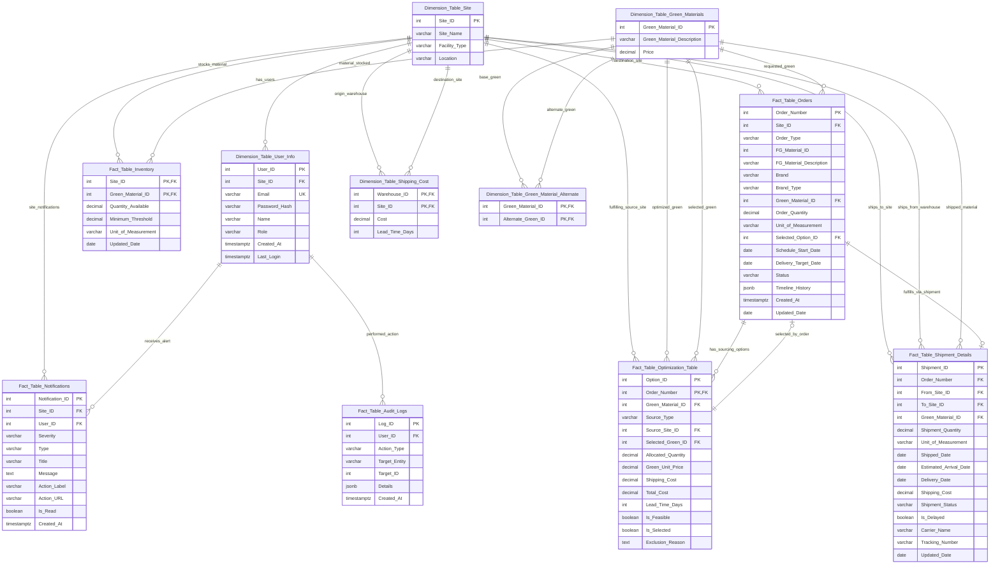

# KDP GreenSource — Streamlined Direct-Optimizer Sourcing & Replenishment ER Architecture

## 1. Executive Summary & Flow Redesign

### A. Central Warehouse Direct Inventory Visibility (No RFQ Broadcasts Needed)
In the previous model, roasting sites sent Request For Quote (RFQ) transfer broadcasts to all 3 central warehouses, waiting for warehouse managers to respond with full, partial, or decline quotes.
**In the updated architecture:**
1. **Central Warehouse Stock Tracked in Database:** All inventory — both roasting plant floor bins and central distribution hubs (Warehouses 1055, 1020, 1021) — is tracked in real-time in `Fact_Table_Inventory`.
2. **Optimizer Computes Feasible & Optimal Paths Directly:** 
   * The system optimizer directly queries `Fact_Table_Inventory` across all sites and `Dimension_Table_Shipping_Cost`.
   * The optimizer evaluates all 5 fulfillment scenarios:
     1. **Local Site — Same Green Bean** (0 freight, 0 lead time)
     2. **Local Site — Alternate Approved Bean** (0 freight, 0 lead time)
     3. **Central Warehouse — Same Green Bean** (freight + lead time from `Dimension_Table_Shipping_Cost`)
     4. **Central Warehouse — Alternate Green Bean** (freight + lead time from `Dimension_Table_Shipping_Cost`)
     5. **Split Fulfillment** (immediate local partial stock + remainder from central warehouse)
   * The optimizer dynamically flags the **Most Cost-Optimized Option** (`MIN(Total_Cost)` among feasible options) and the **Fastest Delivery Option** (`MIN(Lead_Time_Days)` among feasible options).
3. **No Warehouse Rejections or Partial Quotes:** 
   * Because central inventory is verified before request generation, the system only requests exact available stock.
   * Central Warehouse Managers do not submit bids or partial declines. They receive verified transfer orders and simply click **Approve & Allocate**, then **Dispatch**.
4. **End-to-End Execution Flow:**
   ```text
   [Production Demand / Replenishment Triggered]
                         │
                         ▼
   [Optimizer Evaluates 5 Scenarios & Writes to Fact_Table_Optimization_Table]
                         │
                         ▼
   [Buyer Reviews Options: Cost-Optimal vs Fastest Badges]
                         │
                         ▼
   [Buyer Selects Option -> Order Created with Status = 'requested', Selected_Option_ID = Option_ID]
                         │
                         ▼
   [Central Warehouse Manager: "Approve & Allocate" -> Status = 'accepted']
                         │
                         ▼
   [Central Warehouse Manager: "Dispatch to Dock" -> Status = 'in transit', Shipment Created]
                         │
                         ▼
   [Local Roasting Dock: Carrier Delivers Beans -> Status = 'delivered']
                         │
                         ▼
   [Local Buyer: "Check-in & Receive" -> Status = 'received' -> 'closed']
   ```

---

### B. Database Storage of Optimization Results (`Fact_Table_Optimization_Table`)

#### **Will the database store each optimization result for an order's `Option_ID` to reference data from the optimization table?**

**YES, absolutely.** Every candidate scenario evaluated by the optimizer for an order is persisted as a distinct row in `Fact_Table_Optimization_Table`.

#### 1. Why persist every option and not just the winning one?
* **Audit Trail & Decision Explainability:** Enterprise procurement compliance requires a permanent record of *why* an option was chosen over others. For instance, if an auditor asks why $589 freight was paid for Warehouse 1055 instead of roasting local beans, the database clearly records that Option 1 (Local Same) was `Is_Feasible = FALSE` with `Exclusion_Reason = 'Stockout: only 400 kg available vs 1,200 kg demand'`.
* **Dynamic Badging & Real-Time Analytics:** Storing all options under `Order_Number` allows SQL queries and the UI to calculate:
  * **Cost-Optimal Badge:** `MIN(Total_Cost)` where `Is_Feasible = TRUE`
  * **Fastest Delivery Badge:** `MIN(Lead_Time_Days)` where `Is_Feasible = TRUE`
* **Historical Sourcing Baseline:** If a shipping route or warehouse experiences a sudden disruption prior to dispatch, the buyer can inspect the historical evaluated options directly without recalculating stale states.

#### 2. Relational Linking via `Selected_Option_ID` (Strict 3NF)
Instead of copying fulfilling site, bean ID, freight cost, total cost, and lead time into `Fact_Table_Orders`, `Fact_Table_Orders` only holds `Selected_Option_ID (FK)`. Downstream analytics join through `Fact_Table_Optimization_Table`:
```sql
SELECT 
    o.Order_Number,
    o.Order_Type,
    o.Order_Quantity,
    o.Status,
    opt.Source_Type,
    opt.Source_Site_ID AS Fulfilling_Site_ID,
    opt.Selected_Green_ID AS Final_Green_ID,
    opt.Green_Unit_Price,
    opt.Shipping_Cost,
    opt.Total_Cost,
    opt.Lead_Time_Days
FROM Fact_Table_Orders o
JOIN Fact_Table_Optimization_Table opt 
  ON o.Order_Number = opt.Order_Number 
 AND o.Selected_Option_ID = opt.Option_ID;
```

---

### C. Order History vs. Purchase History

The user requested clarification on how to handle **Order History** (orders received by the facility to fulfill finished goods demand) versus **Purchase History** (bean procurement orders placed by the facility for replenishment or production):

| Criteria | Order History | Purchase History |
| :--- | :--- | :--- |
| **Business Meaning** | Finished goods production schedule / demand received by the plant to roast. | Green bean restock/procurement requisitions placed to central warehouses. |
| **`Order_Type`** | `'PRODUCTION'` | `'REPLENISHMENT'` |
| **Order Number Convention** | `1000`–`2999` (e.g. `2846`, `2847`) | `3000`–`4999` (e.g. `3001`, `3002`) |
| **Primary Identifier Type** | `int` | `int` |
| **Why Keep Same Unified Table?** | Both use identical lifecycle states (`new`, `requested`, `accepted`, `dispatched`, `in transit`, `delivered`, `closed`), both link to `Fact_Table_Optimization_Table` for sourcing, and both link to `Fact_Table_Shipment_Details` for inbound logistics. |

**Recommendation:** Maintain both in `Fact_Table_Orders` using integer primary keys, partitioned logically in the UI:
* **Order History Page:** Filters `WHERE Order_Type = 'PRODUCTION'`
* **Purchase History Page:** Filters `WHERE Order_Type = 'REPLENISHMENT'`

---

### D. Clean 3NF Normalization Principles Applied

1. **Eliminated `Fact_Table_Warehouse_Quotes`:** Central warehouse inventory is known in the DB; competitive bidding is replaced by automated system optimization.
2. **Added `Lead_Time_Days` to `Dimension_Table_Shipping_Cost`:** Transit times are static characteristics of logistics corridors between sites.
3. **Removed Redundant Columns from `Fact_Table_Optimization_Table`:**
   * `Estimated_Arrival_Date`: Derived dynamically from `Order_Date + Lead_Time_Days`.
   * `Is_Cost_Optimal` & `Is_Fastest`: Calculated dynamically via `MIN(Total_Cost)` and `MIN(Lead_Time_Days)` across feasible rows.
4. **Removed Redundant Columns from `Fact_Table_Orders`:**
   * `Order_Category`: Already represented by `Order_Type` (`'PRODUCTION'` vs `'REPLENISHMENT'`).
   * `Fulfilling_Site_ID`, `Final_Green_ID`, `Shipping_Cost`, `Total_Delivered_Cost`, `Lead_Time_Days`: Derived cleanly by joining to `Fact_Table_Optimization_Table` on `(Order_Number, Selected_Option_ID)`.

---

## 2. Table Classification (Dimension vs. Fact)

| Table Name | Category | Primary Key | Description & Role |
| :--- | :--- | :--- | :--- |
| **`Dimension_Table_Site`** | **Dimension** | `Site_ID` (int) | Facilities: Roasting plants (e.g. 1054 Plano, 1003 Sumner) and Central Hubs (1055, 1020, 1021). |
| **`Dimension_Table_User_Info`** | **Dimension** | `User_ID` (int) | System actors: Local Buyers, Central Warehouse Managers, Logistics Planners. |
| **`Dimension_Table_Green_Materials`** | **Dimension** | `Green_Material_ID` (int) | Master catalog of green coffee varieties and baseline spot price per kg. |
| **`Dimension_Table_Green_Material_Alternate`** | **Dimension** | `(Green_Material_ID, Alternate_Green_ID)` | Approved bean substitution relationships. |
| **`Dimension_Table_Shipping_Cost`** | **Dimension** | `(Warehouse_ID, Site_ID)` | Shipping freight cost matrix and transit **`Lead_Time_Days`** between facilities. |
| **`Fact_Table_Inventory`** | **Fact** | `(Site_ID, Green_Material_ID)` | **Physical ground-truth stock on-hand** (`Quantity_Available`, `Minimum_Threshold`). Covers both local plants and central warehouses. |
| **`Fact_Table_Orders`** | **Fact** | `Order_Number` (int) | Production and replenishment orders with lifecycle status and `Selected_Option_ID FK`. |
| **`Fact_Table_Optimization_Table`** | **Fact** | `(Order_Number, Option_ID)` | **Persisted candidate sourcing scenarios** per order (costs, freight, lead time, feasibility, selection flag). |
| **`Fact_Table_Shipment_Details`** | **Fact** | `Shipment_ID` (int) | Physical freight movements dispatched from central warehouse to plant dock. |
| **`Fact_Table_Notifications`** | **Fact** | `Notification_ID` (int) | Real-time threshold breach, dispatch, and delivery alerts. |
| **`Fact_Table_Audit_Logs`** | **Fact** | `Log_ID` (int) | Immutable compliance log of all user and system status transitions. |

---

## 3. Mermaid Entity-Relationship Diagram



---

## 4. SQL DDL Table Schemas & Foreign Keys

```sql
-- 1. Sites (Plants & Central Hubs)
CREATE TABLE Dimension_Table_Site (
    Site_ID INT PRIMARY KEY,
    Site_Name VARCHAR(100) NOT NULL,
    Facility_Type VARCHAR(50) NOT NULL CHECK (Facility_Type IN ('ROASTING_PLANT', 'CENTRAL_WAREHOUSE')),
    Location VARCHAR(150) NOT NULL
);

-- 2. Users
CREATE TABLE Dimension_Table_User_Info (
    User_ID INT PRIMARY KEY,
    Site_ID INT NOT NULL REFERENCES Dimension_Table_Site(Site_ID),
    Email VARCHAR(150) UNIQUE NOT NULL,
    Password_Hash VARCHAR(255) NOT NULL,
    Name VARCHAR(100) NOT NULL,
    Role VARCHAR(50) NOT NULL CHECK (Role IN ('BUYER', 'WAREHOUSE_MANAGER', 'PLANT_PLANNER', 'ADMIN')),
    Created_At TIMESTAMPTZ DEFAULT CURRENT_TIMESTAMP,
    Last_Login TIMESTAMPTZ
);

-- 3. Green Materials Catalog
CREATE TABLE Dimension_Table_Green_Materials (
    Green_Material_ID INT PRIMARY KEY,
    Green_Material_Description VARCHAR(150) NOT NULL,
    Price DECIMAL(10,2) NOT NULL CHECK (Price >= 0)
);

-- 4. Approved Material Alternates
CREATE TABLE Dimension_Table_Green_Material_Alternate (
    Green_Material_ID INT NOT NULL REFERENCES Dimension_Table_Green_Materials(Green_Material_ID),
    Alternate_Green_ID INT NOT NULL REFERENCES Dimension_Table_Green_Materials(Green_Material_ID),
    PRIMARY KEY (Green_Material_ID, Alternate_Green_ID)
);

-- 5. Shipping Cost Matrix & Lead Time
CREATE TABLE Dimension_Table_Shipping_Cost (
    Warehouse_ID INT NOT NULL REFERENCES Dimension_Table_Site(Site_ID),
    Site_ID INT NOT NULL REFERENCES Dimension_Table_Site(Site_ID),
    Cost DECIMAL(10,2) NOT NULL CHECK (Cost >= 0),
    Lead_Time_Days INT NOT NULL CHECK (Lead_Time_Days >= 0),
    PRIMARY KEY (Warehouse_ID, Site_ID)
);

-- 6. Unified Inventory (Local Plants & Central Warehouses)
CREATE TABLE Fact_Table_Inventory (
    Site_ID INT NOT NULL REFERENCES Dimension_Table_Site(Site_ID),
    Green_Material_ID INT NOT NULL REFERENCES Dimension_Table_Green_Materials(Green_Material_ID),
    Quantity_Available DECIMAL(12,2) NOT NULL DEFAULT 0 CHECK (Quantity_Available >= 0),
    Minimum_Threshold DECIMAL(12,2) NOT NULL DEFAULT 0 CHECK (Minimum_Threshold >= 0),
    Unit_of_Measurement VARCHAR(20) DEFAULT 'kg',
    Updated_Date DATE NOT NULL DEFAULT CURRENT_DATE,
    PRIMARY KEY (Site_ID, Green_Material_ID)
);

-- 7. Orders (Production Demands & Replenishments)
CREATE TABLE Fact_Table_Orders (
    Order_Number INT PRIMARY KEY,
    Site_ID INT NOT NULL REFERENCES Dimension_Table_Site(Site_ID),
    Order_Type VARCHAR(50) NOT NULL CHECK (Order_Type IN ('PRODUCTION', 'REPLENISHMENT')),
    FG_Material_ID INT,
    FG_Material_Description VARCHAR(150),
    Brand VARCHAR(100),
    Brand_Type VARCHAR(50),
    Green_Material_ID INT NOT NULL REFERENCES Dimension_Table_Green_Materials(Green_Material_ID),
    Order_Quantity DECIMAL(12,2) NOT NULL CHECK (Order_Quantity > 0),
    Unit_of_Measurement VARCHAR(20) DEFAULT 'kg',
    Selected_Option_ID INT, -- References Fact_Table_Optimization_Table(Option_ID)
    Schedule_Start_Date DATE NOT NULL,
    Delivery_Target_Date DATE,
    Status VARCHAR(50) NOT NULL CHECK (Status IN ('new', 'approved', 'requested', 'accepted', 'dispatched', 'in transit', 'delivered', 'received', 'closed')),
    Timeline_History JSONB DEFAULT '[]'::jsonb,
    Created_At TIMESTAMPTZ DEFAULT CURRENT_TIMESTAMP,
    Updated_Date DATE NOT NULL DEFAULT CURRENT_DATE
);

-- 8. Persisted Sourcing Scenarios per Order
CREATE TABLE Fact_Table_Optimization_Table (
    Option_ID INT NOT NULL,
    Order_Number INT NOT NULL REFERENCES Fact_Table_Orders(Order_Number) ON DELETE CASCADE,
    Green_Material_ID INT NOT NULL REFERENCES Dimension_Table_Green_Materials(Green_Material_ID),
    Source_Type VARCHAR(50) NOT NULL CHECK (Source_Type IN ('LOCAL_SAME', 'LOCAL_ALT', 'WH_SAME', 'WH_ALT', 'SPLIT')),
    Source_Site_ID INT NOT NULL REFERENCES Dimension_Table_Site(Site_ID),
    Selected_Green_ID INT NOT NULL REFERENCES Dimension_Table_Green_Materials(Green_Material_ID),
    Allocated_Quantity DECIMAL(12,2) NOT NULL CHECK (Allocated_Quantity >= 0),
    Green_Unit_Price DECIMAL(10,2) NOT NULL,
    Shipping_Cost DECIMAL(10,2) NOT NULL DEFAULT 0,
    Total_Cost DECIMAL(12,2) NOT NULL CHECK (Total_Cost >= 0),
    Lead_Time_Days INT NOT NULL DEFAULT 0,
    Is_Feasible BOOLEAN NOT NULL DEFAULT TRUE,
    Is_Selected BOOLEAN NOT NULL DEFAULT FALSE,
    Exclusion_Reason TEXT,
    PRIMARY KEY (Order_Number, Option_ID)
);

-- Foreign Key from Orders to Selected Option
ALTER TABLE Fact_Table_Orders 
    ADD CONSTRAINT fk_selected_option 
    FOREIGN KEY (Order_Number, Selected_Option_ID) 
    REFERENCES Fact_Table_Optimization_Table(Order_Number, Option_ID);

-- 9. Logistics Shipments
CREATE TABLE Fact_Table_Shipment_Details (
    Shipment_ID INT PRIMARY KEY,
    Order_Number INT NOT NULL REFERENCES Fact_Table_Orders(Order_Number),
    From_Site_ID INT NOT NULL REFERENCES Dimension_Table_Site(Site_ID),
    To_Site_ID INT NOT NULL REFERENCES Dimension_Table_Site(Site_ID),
    Green_Material_ID INT NOT NULL REFERENCES Dimension_Table_Green_Materials(Green_Material_ID),
    Shipment_Quantity DECIMAL(12,2) NOT NULL CHECK (Shipment_Quantity > 0),
    Unit_of_Measurement VARCHAR(20) DEFAULT 'kg',
    Shipped_Date DATE,
    Estimated_Arrival_Date DATE,
    Delivery_Date DATE,
    Shipping_Cost DECIMAL(10,2) DEFAULT 0,
    Shipment_Status VARCHAR(50) NOT NULL CHECK (Shipment_Status IN ('STAGED', 'IN_TRANSIT', 'DELIVERED', 'RECEIVED')),
    Is_Delayed BOOLEAN DEFAULT FALSE,
    Carrier_Name VARCHAR(100),
    Tracking_Number VARCHAR(100),
    Updated_Date DATE NOT NULL DEFAULT CURRENT_DATE
);

-- 10. Notifications
CREATE TABLE Fact_Table_Notifications (
    Notification_ID INT PRIMARY KEY,
    Site_ID INT NOT NULL REFERENCES Dimension_Table_Site(Site_ID),
    User_ID INT NOT NULL REFERENCES Dimension_Table_User_Info(User_ID),
    Severity VARCHAR(20) NOT NULL CHECK (Severity IN ('LOW', 'MEDIUM', 'HIGH', 'CRITICAL')),
    Type VARCHAR(50) NOT NULL,
    Title VARCHAR(150) NOT NULL,
    Message TEXT NOT NULL,
    Action_Label VARCHAR(100),
    Action_URL VARCHAR(255),
    Is_Read BOOLEAN NOT NULL DEFAULT FALSE,
    Created_At TIMESTAMPTZ DEFAULT CURRENT_TIMESTAMP
);

-- 11. Audit Logs
CREATE TABLE Fact_Table_Audit_Logs (
    Log_ID INT PRIMARY KEY,
    User_ID INT NOT NULL REFERENCES Dimension_Table_User_Info(User_ID),
    Action_Type VARCHAR(100) NOT NULL,
    Target_Entity VARCHAR(100) NOT NULL,
    Target_ID INT NOT NULL,
    Details JSONB DEFAULT '{}'::jsonb,
    Created_At TIMESTAMPTZ DEFAULT CURRENT_TIMESTAMP
);
```
